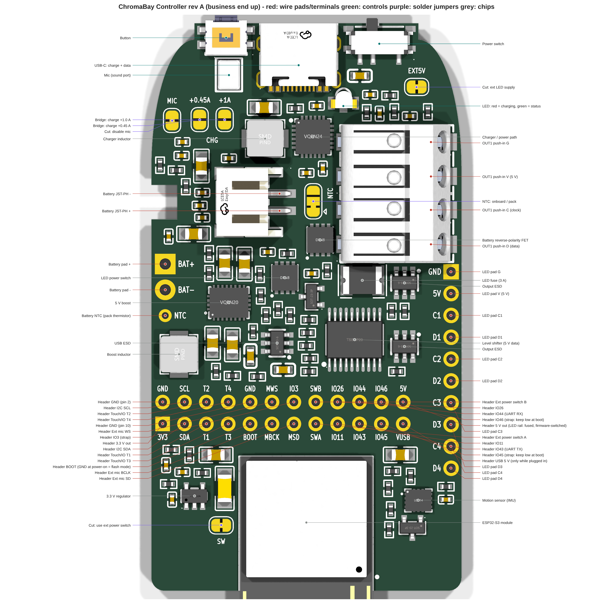
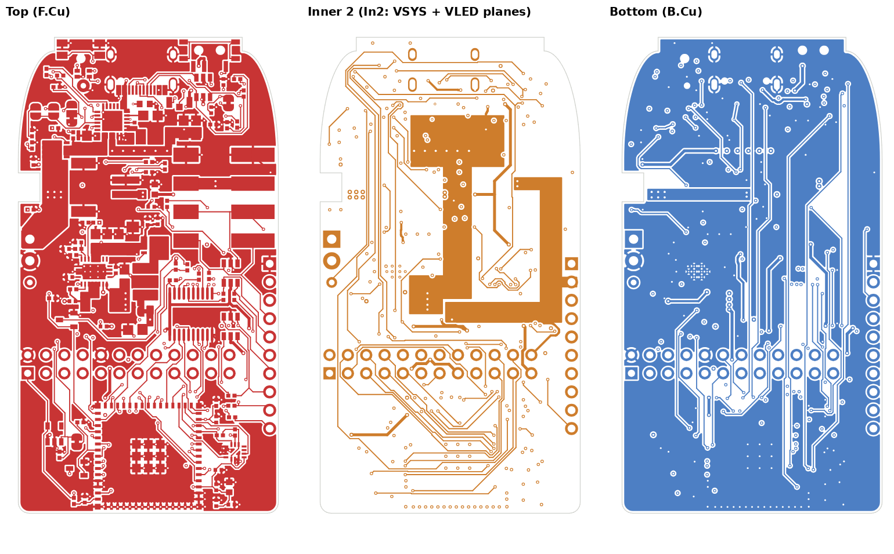
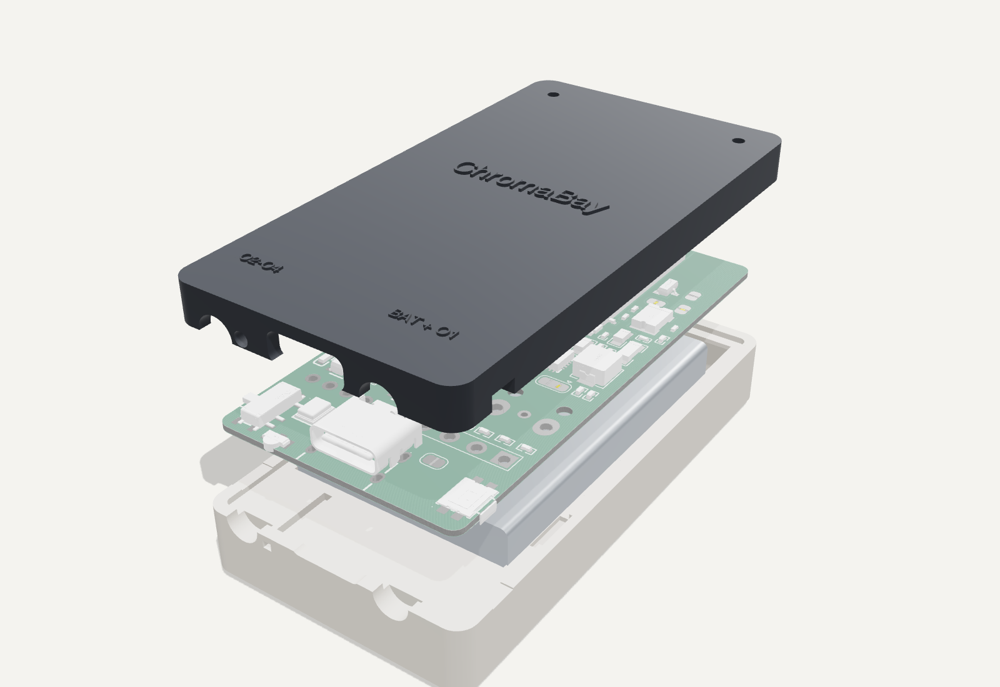

# ChromaBay Controller (rev A)

A battery-powered ESP32-S3 LED controller: USB-C charging with a power path, a 5 V / 2 A LED rail, 4 clock+data
outputs (or 8 single-wire), a PDM mic, a 6-axis IMU, a swappable JST-PH battery and solder-free push-in LED terminals, on
36 × 66 mm (1.6 mm, rounded nose) with the button, USB-C and power switch all at one end, flush with the case
face (the button and switch stick out past it on their own).
The design reasoning is in [DESIGN.md](DESIGN.md). **Interactive 3D mock:** [viewer/index.html](viewer/index.html)
(needs the model files; see "Regenerate").

**Status:** schematic complete and ERC-clean. **Board fully routed:** DRC shows 0 errors and 0 unrouted. The charger
and boost power stage is hand-laid-out with copper pours (`tools/power_layout.py`), and the rest is autorouted. See
DESIGN.md section 0g. Before ordering: review it in KiCad and check part rotations in JLC's 3D preview.

| | |
|---|---|
|  |  |
|  |  |

## Files

| Path | What |
|---|---|
| `chromabay-controller.kicad_pro/.kicad_sch/.kicad_pcb` | KiCad 9 project. Open the `.kicad_pro`. |
| `chromabay-controller-schematic.pdf` | Schematic PDF |
| `lib/lcsc.*` | Symbols, footprints and 3D models for the exact JLC/LCSC parts (via easyeda2kicad) |
| `lib/cb.pretty` | Board-specific footprints: LED output pads, battery pads |
| `tools/design.py` | **Single source of truth**: every part, LCSC code and net |
| `tools/outline.py` | Board outline (rounded nose, battery notch), shared by the board and the case |
| `tools/gen_sch.py`, `tools/gen_pcb.py` | Generate the schematic and the placed board from `design.py` |
| `tools/jlc_cost.py`, `tools/jlc_lookup.py` | Live JLC prices / Basic-vs-Extended status, and the order cost estimate |
| `tools/jlc_files.py` → `fab/` | JLC BOM + CPL for each build: `complete`, `plug`, `core` |
| `tools/cost_options.py` | What each optional feature costs per board |
| `case/case.py` → `case/out/*.stl` | Parametric clamshell case: `external`, `slim` (603450 cell), `thick` (103450 cell), `brick` (2 × 18650) |
| `tools/route.py` | Autoroute: GND fan-out, DSN export (In1 kept as plane), Freerouting 1.9, SES import, zone fill |
| `tools/power_layout.py` | Hand layout of the charger/boost power copper: pours, In2 plane regions, via arrays, short links |
| `tools/fix_silk.py` | Nudges user-header labels off vias, pads and part outlines on the routed board (re-run after regenerating) |
| `tools/fanout.py`, `tools/patch_route.py` | GND via fan-out; small maze router for leftover gaps (+ via merge) |
| `tools/label_render.py` | Labeled top-view render |
| `renders/` | Board renders (KiCad), labeled interaction-point view, case/battery renders (three.js) |
| `viewer/index.html` | Rotatable 3D mock: board + case variants + clickable connection markers |

## Regenerate

```sh
# KiCad 9 (kicad-cli + its python), easyeda2kicad, cadquery
python3 tools/gen_sch.py && kicad-cli sch erc ../chromabay-controller.kicad_sch   # from tools/
/usr/bin/python3 tools/gen_pcb.py        # KiCad's system python (has pcbnew)
python3 tools/jlc_files.py               # fab/bom-jlc.csv, fab/cpl-jlc.csv
python3 tools/jlc_cost.py 5 10 30        # live cost table
python3 case/case.py                     # case STLs (add STEP by editing the export list)
```

`gen_pcb.py` re-places everything, so **once routing starts, stop regenerating the PCB**: from then on, edit the
schematic in KiCad and use *Update PCB from Schematic*. The symbol/footprint UUID links already match.

## Before ordering

Ready to upload: `fab/gerbers-jlc.zip` (Gerbers + drill), `fab/bom-jlc-<build>.csv` and
`fab/cpl-jlc-<build>.csv` for the build you want (`complete`, `plug` or `core`). Regenerate the Gerbers after any
board edit (see DESIGN.md).

1. Look over the board in KiCad, especially the charger corner by the USB-C.
2. At JLC: 4 layers, 1.6 mm, tented vias, "Economic" PCBA on the top side. In the parts-placement preview, check
   **every** part's rotation and position. The easyeda2kicad parts are usually right, but the USB-C, slide
   switch, button, LED, WAGOs, JST, mic and the QFN/DFN power chips are the ones to look at.
3. Expect JLC to ask about the button and switch overhanging the board edge (on purpose) and the 0.35/0.2 mm
   REGN vias.
4. Optional: confirm the boost compensation (10k / 10 nF / 47 pF) in TI WEBENCH.
5. Order 2–5 to validate. Tests: charge current per jumper setting, boost ripple and efficiency at 2 A, run while
   charging from a weak port, reverse-battery protection, 8 outputs, mic, IMU, deep-sleep current with the switch off.
