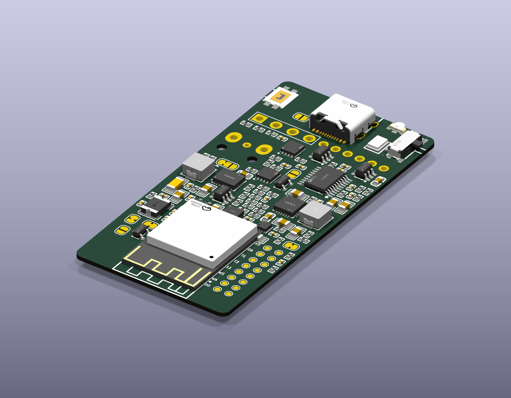
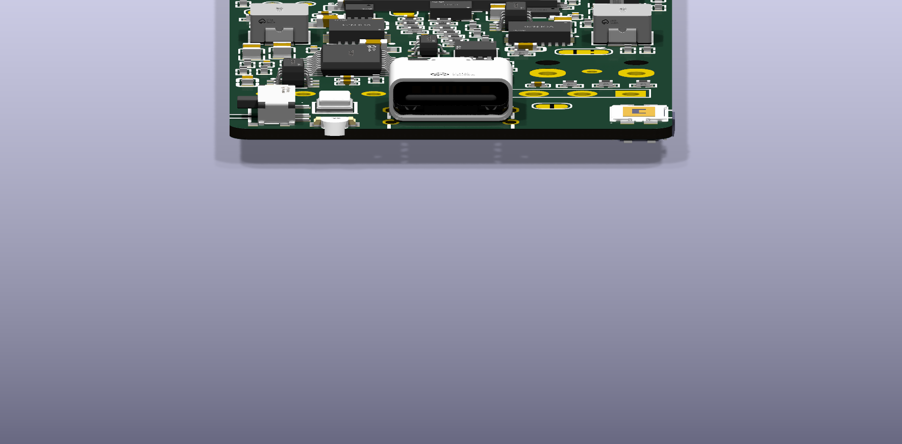
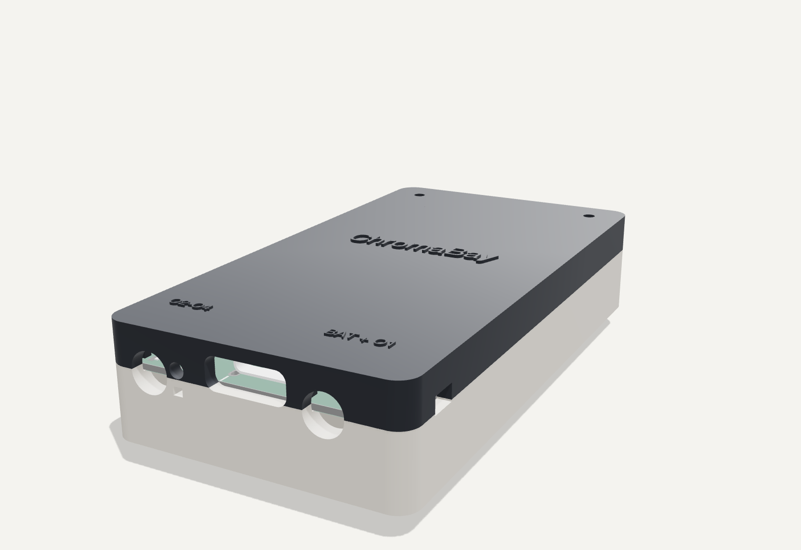

# ChromaBay Controller (rev A)

A battery-powered ESP32-S3 LED controller: USB-C charging with a power path, a 5 V / 2 A LED rail, 4 clock+data
outputs (or 8 single-wire), a PDM mic, a 6-axis IMU, all on 32 × 64 mm with every port at one end.
The design reasoning is in [DESIGN.md](DESIGN.md).

**Status:** the schematic is complete and ERC-clean. All 120 parts are placed and the board passes DRC and schematic
parity, apart from expected unrouted connections and silkscreen cosmetics. **The board is not routed yet**, so it
isn't ready to order. Remaining work is in DESIGN.md section 0.

| | |
|---|---|
|  |  |
|  |  |

## Files

| Path | What |
|---|---|
| `chromabay-controller.kicad_pro/.kicad_sch/.kicad_pcb` | KiCad 9 project. Open the `.kicad_pro`. |
| `chromabay-controller-schematic.pdf` | Schematic PDF |
| `lib/lcsc.*` | Symbols, footprints and 3D models for the exact JLC/LCSC parts (via easyeda2kicad) |
| `lib/cb.pretty` | Board-specific footprints: LED output row, battery pads |
| `tools/design.py` | **Single source of truth**: every part, LCSC code and net |
| `tools/gen_sch.py`, `tools/gen_pcb.py` | Generate the schematic and the placed board from `design.py` |
| `tools/jlc_cost.py`, `tools/jlc_lookup.py` | Live JLC prices / Basic-vs-Extended status, and the order cost estimate |
| `tools/jlc_files.py` → `fab/` | JLC assembly BOM + CPL |
| `case/case.py` → `case/out/*.stl` | Parametric clamshell case: `external`, `slim` (603045 cell), `thick` (103045 cell) |
| `renders/` | Board renders (KiCad) and case/battery renders (three.js) |

## Regenerate

```sh
# KiCad 9 (kicad-cli + its python), easyeda2kicad, cadquery
python3 tools/gen_sch.py && kicad-cli sch erc ../chromabay-controller.kicad_sch   # from tools/
/usr/bin/python3 tools/gen_pcb.py        # KiCad's system python (has pcbnew)
python3 tools/jlc_files.py               # fab/bom-jlc.csv, fab/cpl-jlc.csv
python3 tools/jlc_cost.py 5 10 30        # live cost table
python3 case/case.py                     # case STLs (add STEP by editing the export list)
```

`gen_pcb.py` re-places everything, so **once routing starts, stop regenerating the PCB**: from then on, edit the
schematic in KiCad and use *Update PCB from Schematic*. The symbol/footprint UUID links already match.

## Before ordering

1. Route it. Hand-route the charger (BQ25606) and boost (TPS61088) power loops first, then the rest.
2. Check the boost compensation (R/C on COMP) and RFREQ in TI WEBENCH.
3. Upload Gerbers + `fab/` to JLC and check every part's rotation in their 3D preview.
4. Order 2–5 to validate. Tests: charge current per jumper setting, boost ripple and efficiency at 2 A, run while
   charging from a weak port, reverse-battery protection, 8 outputs, mic, IMU, deep-sleep current with the switch off.
